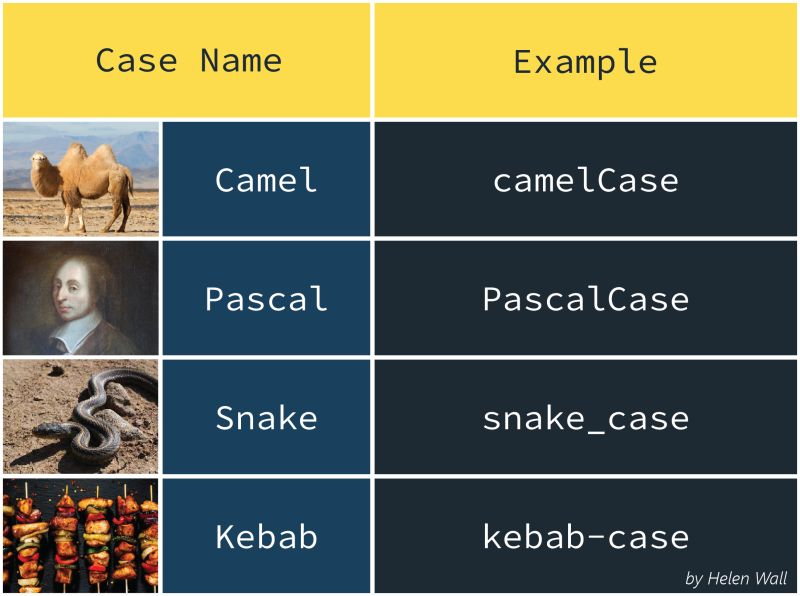

# Verna C++/Qt Guidelines Including Standards & Clean Code

## Purpose

To ensure consistent, maintainable, high-quality C++ and Qt code across all Verna projects by applying modern standards and clean code principles.

## Scope

This guide applies to all developers working on C++/Qt projects using Qt Creator. It defines conventions for code structure, design clarity, modern C++ practices, Qt usage, documentation, testing, and collaboration.

## Core Guidelines

### Clean Code Principles

#### Named Case Handling

Use consistent naming styles throughout your codebase to improve readability and avoid confusion:



* **PascalCase** – Use for class names, namespace and enum types.

  * ✅ `UserManager`, `LoginDialog`
* **camelCase** – Use for variables, function names, enum member names and object instances.

  * ✅ `retryCount`, `loadFromFile()`, `dataStream`
* **snake\_case** – Avoid in general Verna C++ style unless interfacing with C APIs or legacy systems.
* **kebab-case** – Never use in code identifiers (only acceptable for filenames or CLI arguments).

Sometimes there are some exceptions:

* Use **CAPITALCASE** for abbreviations in class names (e.g., `FPGA`).
* When an abbreviation is combined with another word, separate them using an underscore for readability, resulting in a **MIXED\_Case** format (e.g., `FPGA_Interface`).
* When instantiating such a class which is named **MIXED\_Case** or using it as an object name, convert it to camelCase (e.g., `fpgaInterface`).

#### Using Meaningful Names

Choosing clear, descriptive names helps readers quickly understand the purpose and behavior of code. Favor intent-revealing names over brevity or ambiguity. Don't fear writing longer or more specific names—**clarity is always worth the few extra keystrokes!**

##### Variable Names (Are nouns in 99% of cases)

* ✅ `userAge` instead of ❌ `ua`
* ✅ Avoid prefixes like `m_` (for member variables), e.g., use `count` instead of ❌ `m_count`
* ✅ `QHash<ModelSpecType, ModelSpec*> typeToSpecs;` or `typeSpecHash` in the `Model` class — descriptive and contextual (for member variables)
* ✅ `retryCount` instead of ❌ `r`
* ✅ `boardId` instead of ❌ `modelBoardId` (when used inside `ModelInterface` class — class name already provides context)

##### Function Names Including Qt Sltos (In 95% of cases non-signal functions are verbs)

Function names must clearly describe what the function does. A function should express its single responsibility through its name, avoiding vague or overly general labels.

* ✅ `fetchUserData()` instead of ❌ `getData()`

* ✅ `fetchUserData()` instead of ❌ `getData()`

* ✅ `initializeDatabase()` instead of ❌ `init()`

##### Qt Signal Names

Signal names must clearly describe what the signal does.

**Use Event-Driven and State-Related Names**

Use **gerund nouns** or **descriptive phrases** to name variables or signals that represent ongoing states or events. These names should clearly indicate what the variable or signal represents and how it behaves within the system.

* ✅ `newValue` – indicates a new value that will be emitted or processed.
* ✅ `specNameChanged` – clearly communicates that the specification name has changed (typical signal naming).
* ❌ `val`, `reportStatus`, `flag`, `goFoo` – vague and not intent-revealing.

This convention improves clarity, especially in signal/slot mechanisms or observer patterns commonly used in Qt. It ensures that event-triggered or data-carrying names are self-explanatory and clearly aligned with the application's logic flow.

##### Class Names

Class names should be **nouns**, representing objects, responsibilities, or concepts. They should describe what the class is, not what it does.

* ✅ `PaymentProcessor` instead of ❌ `Processor`
* ✅ `LoginManager` instead of ❌ `Manager`

When classes are nested within a namespace, avoid repeating the namespace name in the class name. Let the namespace provide the context.

* ✅ `Verna::Core::Logger` instead of ❌ `Verna::Core::CoreLogger`

* ✅ `PaymentProcessor` instead of ❌ `Processor`

* ✅ `LoginManager` instead of ❌ `Manager`

##### Namespace Names

The purpose of namespaces in C++ is to avoid name clashes. And that is it. The library stuff you mentioned is the application, which is not the only one.

* ✅ `JuyanCore::Model` instead of ❌ `JuyanCoreModel`
* ✅ `Network::Sockets` instead of ❌ `NetworkSockets`

##### Enum & Enum Class Names

Usually camelCase

* ✅ `enum class Status { success, failure }` instead of ❌ `enum class S { OK, ERR }`
* ✅ `ErrorCode::FileNotFound` instead of ❌ `ErrorCode::E1`

##### Enum Member Names

* ✅ `enum Connection { connected, diconnected }` instead of ❌ `enum class Connection { Connected, Diconnected }`

* ✅ general example:

  ```cpp
  namespace JuyanCore {
      enum ModelType {
          juyan            = 0,
          superPosition0   = 1,
          superPosition1   = 2,
          spot0            = 3,
          sweep0           = 4,
          barrage0         = 5,
          spot1            = 6,
          sweep1           = 7,
          barrage1         = 8,
          jammer0          = 9,
          jammer1          = 10
      };
  }
  ```

#### Writing Self-Documenting and Maintainable Code

Descriptive names reduce the need for comments and eliminate ambiguity. Always aim to make your code **self-documenting**.

* Code must be **readable**, **simple**, and **self-explanatory**. Anyone unfamiliar with the code should be able to understand its purpose quickly. **Write code in a way that eliminates the need for comments unless absolutely necessary.**\`

  ```cpp
  void Device::input(QByteArray data, DeviceType deviceType)
  {
      QMutexLocker locker(&mutex);
      if (Settings::Debug::setting.deviceInputData)
          qDebug() << getName() << "input data from" << toStr(deviceType) << ":\n" << data.toHex().toUpper();
      else if (Settings::Debug::setting.deviceInput)
          qDebug() << getName() << "input";
      inputDeviceType = deviceType;
      if (isStarted()) {
          handleInput(data,deviceType);
          handleInput(data);
      }
  }
  ```

* Functions should be **small**, **pure**, and serve a **single responsibility**. A function that does more than one thing is harder to test, reuse, and maintain.

  For example split the belowing:

  ```cpp
  void Device::config(QByteArray data)
  {
      QMutexLocker locker(&mutex);
      if (Settings::Debug::setting.deviceConfigData)
          qDebug() << getName() << "config data from" << toStr(deviceType) << ":\n" << data.toHex().toUpper();
      else if (Settings::Debug::setting.deviceConfig)
          qDebug() << getName() << "config";
      
      QDataStream dataStream(&data, QIODevice::ReadOnly);
      Type type;
      ConfigCommand configCommand;
      ConfigValue configValue;
      dataStream >> type >> configCommand >> configValue;
      handleConfig(type, configCommand, configValue);
  }
  ```

  Into:

  ```cpp
  void Device::config(QByteArray data)
  {
      QMutexLocker locker(&mutex);
      if (Settings::Debug::setting.deviceConfigData)
          qDebug() << getName() << "config data from" << toStr(deviceType) << ":\n" << data.toHex().toUpper();
      else if (Settings::Debug::setting.deviceConfig)
          qDebug() << getName() << "config";
      
  	auto configPacket = decode(data); /// Packed the config decode result
  	handleConfig(configPacket); /// Refactored the handleConfig to use configPacket
  }
  ```

  ```cpp
  Device::ConfigPacket Device::decode(QByteArray data) 
  {
  	QMutexLocker locker(&mutex);
  	ConfigPacket packet;
      dataStream >> packet.type >> packet.command >> packet.Value;
      return packet;
  }
  ```

* Avoid duplication (**DRY** – Don't Repeat Yourself). Repeated logic should be extracted into helper functions or reusable modules.

* Use **meaningful names** that reveal intent. Favor clarity over brevity (e.g., `fetchUserData()` is better than `getData()`).

* Avoid magic values—use `constexpr`, enums, or static constants for configuration, thresholds, or special identifiers.

  For example using below code instead of using the hard code values:

  ```cpp
  namespace AllRegistersAddress {
      namespace SuperPosition {
          static constexpr quint32 spoofCoeficient                = 0x10;
          static constexpr quint32 jammerCoeficient               = 0x18;
          static constexpr quint32 pdwGenCoeficient               = 0x20;
          static constexpr quint32 spoofSampleRate                = 0x8010;
          static constexpr quint32 jammerSampleRate               = 0x8018;
          static constexpr quint32 pdwGenSampleRate               = 0x8020;
      }
  }
  ```

* Embrace **fail-fast thinking** for easier debug. Use `try catch ` ,`assert`, `Q_ASSERT`, or `static_assert` to expose bugs early and make assumptions explicit.

  ```cpp
  IP_Core& Root::operator[](IP_CoreType ipCoreType) const
  {
      try {
          if (hasIpCore(ipCoreType))
              return *getIpCore(ipCoreType);
          else {
              QString ipCoreName;
              for (const auto& argument : allIpCores.argumentsList)
                  if (argument.type == ipCoreType)
                      ipCoreName = argument.name;
              throw "read access violation, " + FPGA_INTERFACE_SETTING.name + " not contains ip-core" + ipCoreName + '!';
          }
      }  catch (const QString& errorStr) {
          std::cerr << errorStr.toStdString().data() << std::endl;
          throw std::exception();
      }
  }
  ```

* Limit the use of comments. Prefer writing code that doesn’t require explanation. Use comments only to explain **why** something is done, not **what** it does.

  For example in `_FPGA_InterfaceList.h`:

  ```
  #pragma once

  ...

  /// IMPORTANT NOTE: Because this file has static variables that other files use, it should be
  /// the first file that linker processes. In order to do that the name of the file starts with '_'
  /// so it is the first one alphabetically.

  namespace FPGA_Interface {
  	...
  }
  ```

* Maintain a consistent style. Inconsistent code is harder to read and introduces cognitive load.

* Avoid side effects. Functions should ideally return values without changing global state or altering input parameters unexpectedly.

* Prefer composition over inheritance. Favor loosely coupled, modular code over deep inheritance hierarchies.

* Optimize for readability first, performance second—unless profiling proves otherwise.

* Leave the code **cleaner than you found it**. Make small refactorings as you touch existing code.

#### The SOLID Principles

The SOLID principles guide object-oriented design toward maintainability and extensibility:


* **S**ingle Responsibility Principle: A class should have one, and only one, reason to change.
  *Example: A **`Logger`** class should only handle logging, not perform formatting or file I/O.*

* **O**pen/Closed Principle: Software entities should be open for extension but closed for modification.
  *Example: Use a base class with virtual functions that can be extended via derived classes instead of modifying the base class.*

* **L**iskov Substitution Principle: Subtypes must be substitutable for their base types.
  *Example: A subclass that overrides behavior and breaks expected usage contracts violates this principle. Ensure derived classes respect the intent and guarantees of the base class.*

* **I**nterface Segregation Principle: Prefer small, specific interfaces over large, general-purpose ones.
  *Example: Instead of one big **`DeviceInterface`**, split it into **`Readable`**, **`Writable`**, etc., so classes only implement what they use.*

* **D**ependency Inversion Principle: Depend on abstractions, not concrete implementations.
  *Example 1: Inject a **`DataSourceInterface`** rather than using a concrete **`FileReader`**.*
  *Example 2: Inject a **`UdpSocketInterface`** into a class which is using sockets instead of directly using **`QUdpSocket`**.*
  *Example 3: Use a **`Logger`** class that uses **`QFile`** internally rather than writing logs directly with **`QFile`**.*
