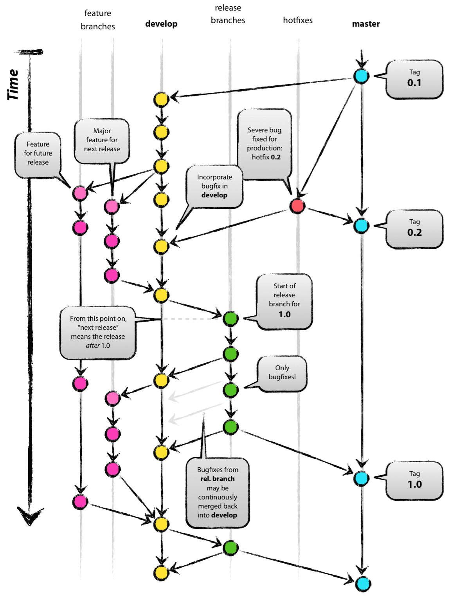

# Git Guidelines

## Git Branching Model
  
At Verna, we follow a structured Git branching strategy to ensure clarity, stability, and parallel development. This model includes long-lived branches and short-lived prefixed branches for specific tasks.

<p align="center">
  
</p>

### 📌 Long-Lived Branches

| Branch     | Purpose |
|------------|---------|
| `main` or `master`     | Stable, production-ready code. Every commit must be **tested** and **deployable**. |
| `develop`  | Integration branch for active development. New features and fixes are **merged** here. |
| `release` | Used to prepare new releases. Final testing, documentation, and versioning happen here. |

---

### 🚧 Short-Lived (Prefixed) Branches

Short-lived branches support day-to-day development tasks and are eventually merged back into `develop`, `release`, or `main`.

| Prefix        | Description |
|---------------|-------------|
| `feature/`    | For implementing new features. Merged into `develop` once complete. |
| `bugfix/`     | For resolving non-critical issues in `develop`. |
| `hotfix/`     | For urgent fixes to production (`main`). Merged into both `main` and `develop`. |
| `refactor/`   | For internal code improvements without behavior changes. |
| `docs/`       | For documentation-related changes like `README.md` or `User_Manual.pdf`. |
| `chore/`      | For configuration, CI, tooling, or formatting changes. |
| `test/`       | For experimental or temporary work. |

---

### 🔄 Branch Flow Example

```bash
# Create a new feature branch
git checkout -b feature/login-page develop

# After work is done, merge back into develop
git checkout develop
git merge --no-ff feature/login-page
git branch -d feature/login-page
```
